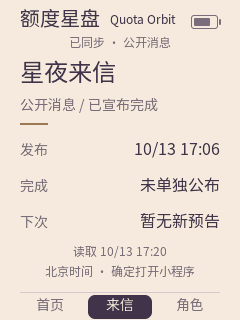
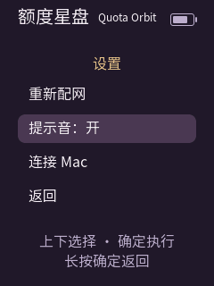
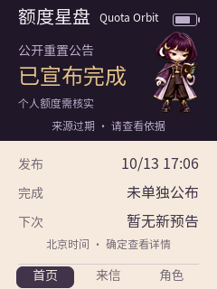
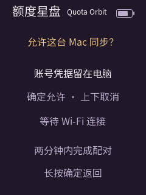
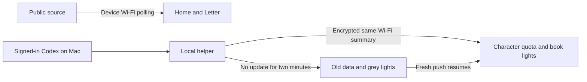

<strong>English</strong> · <a href="README.md">简体中文</a>

# AI Passport · Quota Orbit pocket companion

Three downloads serve different purposes: [Quota Orbit Mac client](https://github.com/koi-lee/quota-orbit/releases/latest) provides desktop-pet and menu-bar quota views without requiring Passport hardware; [Passport Mac helper0.2.0](https://github.com/koi-lee/quota-orbit/releases/tag/passport-helper-v0.2.0) sends quota to paired hardware; [Passport firmware](https://ai-passport.folotoy.cn/plays/1250/) runs on the device. The helper does not replace the main Mac app. Firmware cannot be installed on a Mac. GitHub's automatic Source code archives contain this Mac-client repository, not the Passport firmware source.

## Screens and states

These240×320 images are rendered by the firmware's native LVGL harness, not hardware photographs. Announcements, quota, battery, times and hotspot credentials are fictional demonstration values. See the [Chinese illustrated guide](README.md) for all12 screens. Home/Letter show public information; Character shows quota supplied by the paired Mac. The top icon is battery charge. Star taps affect only the local star count, while book lights follow synced quota and turn grey after two minutes without fresh data.

### Public completion notice

### Public forecast

### Notice details

### Mini-program code and website address

### Personal weekly quota

### Settings

### Wi-Fi setup

### Wi-Fi authentication failure

### Cached public notice while offline

### Stale public source

### Old personal quota and grey book lights

### Approve Mac pairing

## Setup and controls

1. Install community firmware; this replaces the current play and may clear settings. Join the device's displayed Starshore-… hotspot with its displayed password. Open http://192.168.4.1, enter2.4GHz Wi-Fi and save. 已同步·公开消息 confirms success. Retry the form on failure; after timeout or to change networks, hold Confirm and select Settings > Wi-Fi setup.
2. Up/Down switches Home/Letter/Character. Confirm on Home opens Letter, and on Letter opens the WeChat mini-program code; Confirm returns. Tap Confirm on Character for stars; hold for Settings.
3. Sound defaults off. Enabling previews tap/forecast/completion cues. Public data is polled about every five minutes. Fresh new forecasts or completion notices may sound once; first sync, duplicate and old notices are silent.
4. Optional personal quota: sign in to Codex on the Mac, launch the companion and use the same Wi-Fi. Connect USB, click Connect device on the Mac first, wait for hardware boot, select Connect Mac on hardware and approve. Click Start sync; once quota appears, USB can be removed. Keep the Mac awake and the helper running. Pause/Quit stops pushes; revoke pairing on hardware.

## Data flow

Authentication failure means Wi-Fi did not connect: recheck the household network credentials, not the device hotspot password. After setup timeout, reopen setup in hardware Settings. Public sync failure keeps old notices and retries. Missing quota windows remain unavailable; stale quota requires waking the Mac and restoring sync. Automatic device IP rediscovery is not implemented; reconnect/pair after its address changes.

## Evidence and limits

Firmware application9092dc72/community revision2840 is public. Existing user acceptance covers pages, readability, mini-program scan, USB pairing, Wi-Fi sync after unplugging, repeated taps and sound. Controlled forecast/completion and duplicate/mute replay passed. Natural real-message triggering, long-run sleep/network recovery and fresh community installation remain unverified. Only the current Apple silicon Mac was tested; the helper is not Developer ID signed/notarized. Credentials remain on the Mac; do not share pairing files. Example images do not establish current announcements or account quota.
